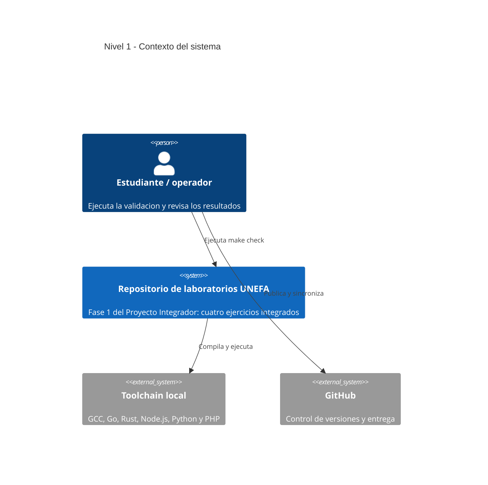
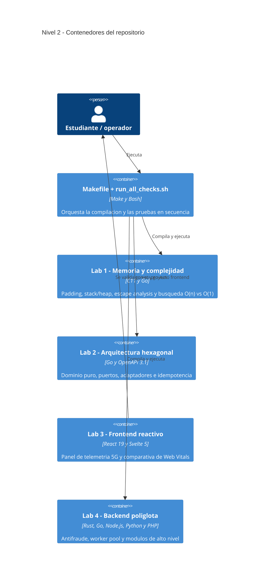

# UNEFA — Lenguaje de Programación II

**Proyecto:** `unefa-1p2-proyecto-semestral` — Fase 1 del Proyecto Integrador Semestral  
**Carrera:** Ingeniería de Sistemas | **Semestre:** 5.° — Período 2-2026  
**Sección SICEU:** 05S-2629-D1

## Integrantes

| # | Integrante | Cédula | GitHub |
|---|------------|--------|--------|
| 1 | Requena Efrén | V-31.312.056 | @ERequena-31312056 |
| 2 | Camejo Génesis | V-30.542.502 | @GCamejo-30542502 |

---

## 1. Descripción general

El repositorio integra los cuatro ejercicios del primer corte en un solo
proyecto. Cada laboratorio demuestra una decisión distinta de memoria,
arquitectura, reactividad o concurrencia. Los laboratorios 1, 2 y 4 se validan
desde la raíz con `make check`; el Lab 3 se documenta en
`lab3_frontend_reactivo/comparativa_web_vitals.md`.

| Laboratorio | Tema | Tecnologías |
|---|---|---|
| Lab 1 | Perfilado de memoria, padding, escape y Big-O | C11, Go |
| Lab 2 | Pasarela de recarga en arquitectura hexagonal | Go, OpenAPI 3.1 |
| Lab 3 | Dashboard comparativo de telemetría 5G | React 19, Svelte 5 |
| Lab 4 | Motor backend políglota sin data races | Rust, Go, Node.js, Python, PHP |

---

## 2. Estructura del repositorio

```text
unefa-1p2-proyecto-semestral/
├── README.md
├── Makefile
├── run_all_checks.sh
├── lab1_memoria_y_complejidad/
│   ├── cdr_memory_profiler.c
│   ├── escape_analyzer.go
│   ├── fta_buffer_overflow.md
│   └── run_all_checks.sh
├── lab2_arquitectura_hexagonal/
│   ├── contracts/openapi_topup.yaml
│   ├── internal/domain/transaccion.go
│   ├── internal/ports/interfaces.go
│   ├── internal/application/servicio_recarga.go
│   ├── internal/adapters/memory_adapter.go
│   └── cmd/api/main.go
├── lab3_frontend_reactivo/
│   ├── nextjs_react19_vdom/TelemetryPanelClient.tsx
│   ├── svelte5_runes_aot/+page.svelte
│   ├── comparativa_web_vitals.md
│   ├── package.json
│   └── tsconfig.json
└── lab4_backend_poliglota/
    ├── rust_antifraude/motor_antifraude.rs
    ├── go_worker_pool/worker_pool.go
    └── runtimes_alto_nivel/
        ├── node_crypto_worker.mjs
        ├── python_async_validator.py
        └── php_jit_tariff_engine.php
```

---

## 3. Diagrama C4

### 3.1 Nivel 1 — Contexto



```text
Nivel 1 — Contexto

  [Estudiante / operador]
          |
          |  make check
          v
  [Repositorio de laboratorios UNEFA]
          |
          |  compila y ejecuta
          v
  [Toolchain local: GCC, Go, Rust, Node.js, Python, PHP]

  [Estudiante / operador] --push/pull--> [GitHub]
```

### 3.2 Nivel 2 — Contenedores



```text
Nivel 2 — Contenedores

  [Estudiante / operador]
          |
          v
  [Makefile + run_all_checks.sh]
          |
          +--> [Lab 1: C11 + Go]
          |        cdr_memory_profiler.c
          |        escape_analyzer.go
          |
          +--> [Lab 2: Go + OpenAPI 3.1]
          |        dominio -> puertos -> aplicacion -> adaptadores
          |
          +--> [Lab 4: Rust + Go + Node + Python + PHP]
          |        motor_antifraude.rs
          |        worker_pool.go
          |        node_crypto_worker.mjs
          |        python_async_validator.py
          |        php_jit_tariff_engine.php
          |
          +--> [Lab 3: React 19 + Svelte 5]
                   TelemetryPanelClient.tsx
                   +page.svelte
```

---

## 4. Informe técnico por laboratorio

### 4.1 Lab 1 — Memoria, padding y complejidad

`cdr_memory_profiler.c` declara dos estructuras con los mismos seis campos. La
primera intercala `char` con `uint64_t` y `uint32_t`, lo que obliga al
compilador a insertar relleno. La segunda ordena los campos de mayor a menor
alineación natural (8, 4, 2, 1, 1, 1), eliminando el padding interno. El
programa imprime las direcciones de una variable global, una local y un bloque
de heap, además de `sizeof` y `offsetof` de cada campo. El bloque se libera con
`free()` y se pone a `NULL`.

`escape_analyzer.go` compara dos constructores: `CrearEnStackPorValor` devuelve
la estructura por valor, mientras que `CrearConEscapeAlHeap` devuelve `&s`, lo
que provoca que `s` se mueva al heap. El benchmark mide con `time.Now()` la
búsqueda de 1.000 elementos dentro de 100.000 abonados, primero con búsqueda
lineal O(n) y luego con un mapa hash O(1).

`fta_buffer_overflow.md` modela la corrupción de RIP por desbordamiento de pila
con un Árbol de Fallos en Mermaid (compuertas AND y OR) y un diagrama de
Ishikawa en ASCII.

### 4.2 Lab 2 — Arquitectura hexagonal

El dominio solo importa `errors` y `regexp` de la biblioteca estándar, por lo
que su índice de inestabilidad es `I = 0`. `TransaccionRecarga` encapsula sus
campos, valida E.164, exige un monto `int64` positivo y controla la máquina de
estados `PENDIENTE -> APROBADA / RECHAZADA`.

Los puertos definen `RepositorioTransacciones`, `PasarelaPagoBancaria` y
`NotificadorAuditoria`. `ServicioRecarga` depende solo de esas interfaces
(principio DIP) y protege la idempotencia con un candado por `Idempotency-Key`:
si la clave ya fue procesada, devuelve la transacción original sin volver a
cobrar. Los adaptadores de memoria usan `sync.RWMutex` y `atomic.Int64`.

El contrato `openapi_topup.yaml` especifica OpenAPI 3.1 con `POST /v1/topups`,
`PUT /v1/topups/{transaction_id}` y `GET /v1/topups/{transaction_id}`, la
cabecera obligatoria `Idempotency-Key` en formato UUID v4 y los códigos 200,
201, 400, 409 y 422.

### 4.3 Lab 3 — Frontend reactivo

`TelemetryPanelClient.tsx` usa la directiva `"use client"`, `useState` para la
ventana deslizante de 200 paquetes y `useMemo` para la latencia promedio y el
conteo de celdas críticas (`latencyMs > 50`). El botón de ráfaga mide con
`performance.now()` y `requestAnimationFrame`.

`+page.svelte` implementa la misma interfaz con Runes de Svelte 5: `$state`
para los paquetes y `$derived.by` para las métricas, sin Virtual DOM.

`comparativa_web_vitals.md` documenta el presupuesto de cuadro (16,67 ms a
60 Hz y 8,33 ms a 120 Hz) y la diferencia entre el diffing O(N) de React y la
propagación O(1) del DAG de señales de Svelte.

### 4.4 Lab 4 — Backend políglota

Rust usa `AlertaFraude<'a>` con referencias `&'a str` para evitar copias en el
heap. Cuatro hilos nativos auditan particiones del lote y actualizan
`Arc<Mutex<EstadisticasRiesgo>>`.

Go implementa la interfaz implícita `ProcesadorTransaccion` y un worker pool de
cuatro goroutines con `jobs <-chan`, `results chan<-`, `sync.WaitGroup` y
contadores `atomic.Int64`.

Node.js delega PBKDF2-SHA-256 a un `Worker` de `node:worker_threads` para no
bloquear el Event Loop. Python valida lotes con `asyncio.gather` y dataclasses
`frozen` con `slots`. PHP usa `strict_types=1`, `enum TipoRed: string`,
`readonly class` y `match`.

---

## 5. Tablas de métricas

### 5.1 Lab 1

| Métrica | Valor observado |
|---|---|
| `sizeof(CDR_Desalineado)` | 32 bytes |
| `sizeof(CDR_Optimizado)` | 24 bytes |
| Ahorro por registro | 8 bytes |
| Ahorro en lote de 10.000.000 | 80.000.000 bytes (80 MB; 76,29 MiB) |
| Registros por línea L1 de 64 bytes | 2 desalineado / 2 optimizado |
| Búsqueda lineal O(n), 1.000 consultas | 54.054,650 µs |
| Búsqueda hash O(1), 1.000 consultas | 22,941 µs |
| Diferencia aproximada | ≈ 2.356× |
| Escape Analysis | `moved to heap: s` en `CrearConEscapeAlHeap` |
| Advertencias de GCC | 0 |

### 5.2 Lab 2

| Métrica | Valor observado |
|---|---|
| `go vet ./...` | 0 hallazgos |
| Pruebas funcionales | 3 de 3 correctas |
| Recarga exitosa | estado `APROBADA` |
| Número que viola E.164 | rechazado con `ErrMSISDNInvalido` |
| Reintentos con la misma clave | 3 concurrentes |
| Cobros efectivos | 1 |
| Endpoints OpenAPI | 3 |
| Códigos HTTP declarados | 200, 201, 400, 409, 422 |
| Dependencias externas del dominio | 0 (`I = 0`) |

### 5.3 Lab 3

| Métrica | React 19 (VDOM) | Svelte 5 (Runes) |
|---|---|---|
| Presupuesto a 60 Hz | 16,67 ms | 16,67 ms |
| Presupuesto a 120 Hz | 8,33 ms | 8,33 ms |
| Complejidad de actualización | O(N) diffing | O(1) DAG de señales |
| Cálculo de métricas | O(W) | O(W) |
| Bundle JS (gzip) | — | — |
| Tiempo de hidratación | — | — |
| INP | — | — |
| Tiempo de actualización | — | — |

### 5.4 Lab 4

| Runtime | Métrica | Valor observado |
|---|---|---|
| Rust | Transacciones auditadas | 12 |
| Rust | Alertas emitidas | 6 |
| Rust | Monto total en alerta | 4.520.000 centavos |
| Rust | Hilos nativos | 4 |
| Go | Transacciones procesadas | 12 |
| Go | Alertas | 6 |
| Go | Resultados recibidos | 12 |
| Go | Workers | 4 |
| Go | Data races con `-race` | 0 |
| Node.js | Iteraciones PBKDF2-SHA-256 | 300.000 |
| Node.js | Ticks del Event Loop | 3 |
| Python | Transacciones válidas | 2 de 5 |
| PHP | Tarifas 2G / 4G / 5G | 360 / 600 / 960 centavos |

### 5.5 Entorno de validación

| Herramienta | Versión validada |
|---|---|
| GNU Make | 4.4.1 |
| GCC | 16.2.0 (MSYS2) |
| Go | 1.27.4 |
| Rust | 1.100.0 |
| Node.js | 24.20.0 |
| Python | 3.14.7 |
| PHP | 8.3.37 (NTS, x64) |

El motor PHP se validó con **PHP 8.3.37**, que cumple el requisito de PHP 8.3+. Para repetir la validación
con 8.3+ basta apuntar la variable `PHP` al ejecutable correspondiente:

```bash
PHP=/ruta/a/php8.3/php.exe make check
```

---

## 6. Guía de ejecución

Desde la raíz del repositorio, ejecuta todas las comprobaciones en secuencia:

```bash
make check
```

Si GNU Make no está instalado, ejecuta directamente el script:

```bash
bash run_all_checks.sh
```

`make check` valida los laboratorios 1, 2 y 4. El Lab 3 se valida con su propio
proyecto frontend.

### 6.1 Comandos individuales

```bash
# Lab 1 - C estricto y ejecucion
gcc -Wall -Wextra -Werror -O0 lab1_memoria_y_complejidad/cdr_memory_profiler.c -o cdr_profiler
./cdr_profiler

# Lab 1 - Escape Analysis y benchmark
go build -gcflags="-m" lab1_memoria_y_complejidad/escape_analyzer.go
go run lab1_memoria_y_complejidad/escape_analyzer.go

# Lab 2 - go vet y bateria de idempotencia
cd lab2_arquitectura_hexagonal && go vet ./... && go run ./cmd/api/main.go && cd ..

# Lab 4 - Rust optimizado
rustc -O lab4_backend_poliglota/rust_antifraude/motor_antifraude.rs -o motor_antifraude
./motor_antifraude

# Lab 4 - Go con detector de carreras
go run -race lab4_backend_poliglota/go_worker_pool/worker_pool.go

# Lab 4 - Node.js, Python y PHP
node lab4_backend_poliglota/runtimes_alto_nivel/node_crypto_worker.mjs
python lab4_backend_poliglota/runtimes_alto_nivel/python_async_validator.py
php -l lab4_backend_poliglota/runtimes_alto_nivel/php_jit_tariff_engine.php
php lab4_backend_poliglota/runtimes_alto_nivel/php_jit_tariff_engine.php
```

### 6.2 Windows (MSYS2)

Si `make` o `bash` no están en el `PATH`, usa la instalación de MSYS2:

```powershell
# Instalar make una sola vez (si falta)
C:\msys64\usr\bin\pacman.exe -S --needed make

# Agregar rustc y las herramientas de MSYS2 al PATH de la sesión actual
$env:PATH = "C:\msys64\usr\bin;$env:USERPROFILE\.cargo\bin;$env:PATH"
& "C:\msys64\usr\bin\bash.exe" -c "make check"
```

