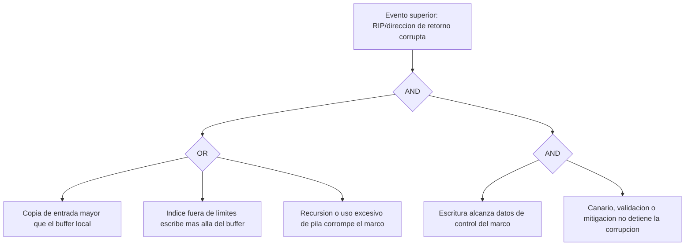

# FTA e Ishikawa: corrupcion de RIP por desbordamiento de pila

Este modelo es didactico: describe condiciones que podrian causar la corrupcion
de la direccion de retorno (RIP en x86-64). No es una guia para explotar un
programa. La distribucion exacta del marco de pila depende del compilador, la
arquitectura y las opciones de compilacion.

## Arbol de Fallos (FTA)

El evento superior requiere que una escritura fuera de limites alcance datos de
control del marco de pila y que las defensas no detengan el incidente. La
compuerta `AND` indica que todas sus condiciones deben ocurrir; la compuerta
`OR` indica que basta una de las causas conectadas.



## Diagrama de Ishikawa

```text
 Memoria             Metodo             Medicion
 Buffer insuficiente Copia sin validar  RIP no observado
 Indice incorrecto   Limites ausentes   Solo prueba nominal
       \                  \                 \
        \                  \                 \
---------\------------------\-----------------\----> RIP corrupta
         /                  /                 /
 Compilacion          Entrada             Mitigaciones
 Marco de pila distinto Longitud extrema  Canario desactivado/fallido
 Optimizacion          Datos inesperados  ASLR/NX no cubren este fallo
```

## Interpretacion y controles

| Categoria | Modo de fallo | Control recomendado |
|---|---|---|
| Memoria | Buffer local menor que los datos recibidos | Validar longitud contra capacidad antes de copiar |
| Metodo | Copias o indices sin limites | Usar APIs con capacidad explicita y revisar limites |
| Entrada | Longitudes extremas o formato inesperado | Validacion de esquema y pruebas de limites |
| Compilacion | Comportamiento distinto por ABI/optimizacion | Probar con advertencias estrictas y sanitizadores |
| Mitigaciones | Defensa ausente o fallo no detectado | Activar protecciones del compilador y defensa en profundidad |
| Medicion | La prueba no detecta corrupcion | Pruebas negativas, analisis estatico y pruebas dinamicas |

El modelo no afirma que todas las causas sean necesarias en cualquier
arquitectura. ASLR y NX reducen ciertos riesgos, pero no sustituyen la
validacion de limites ni garantizan por si solas la integridad del flujo de
control.
